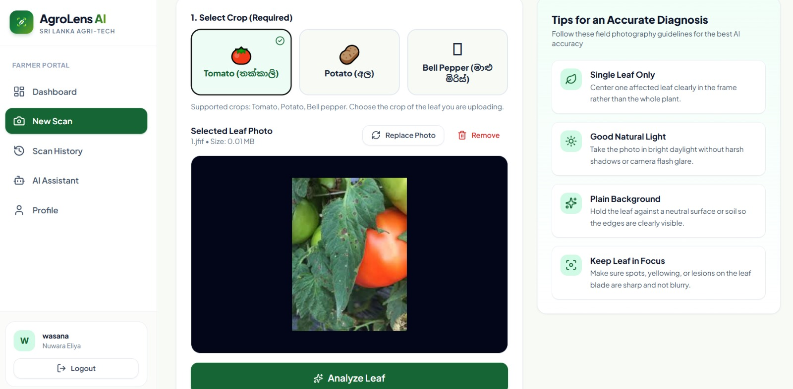
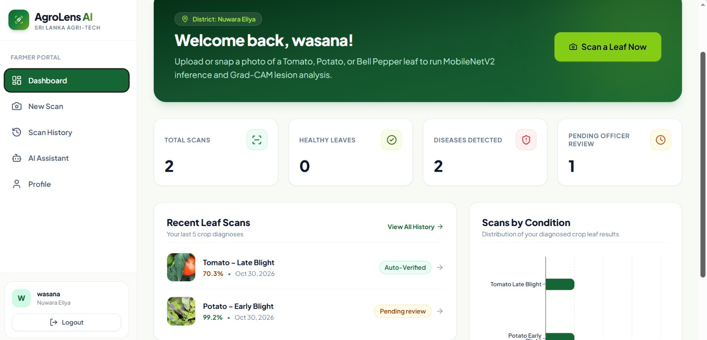
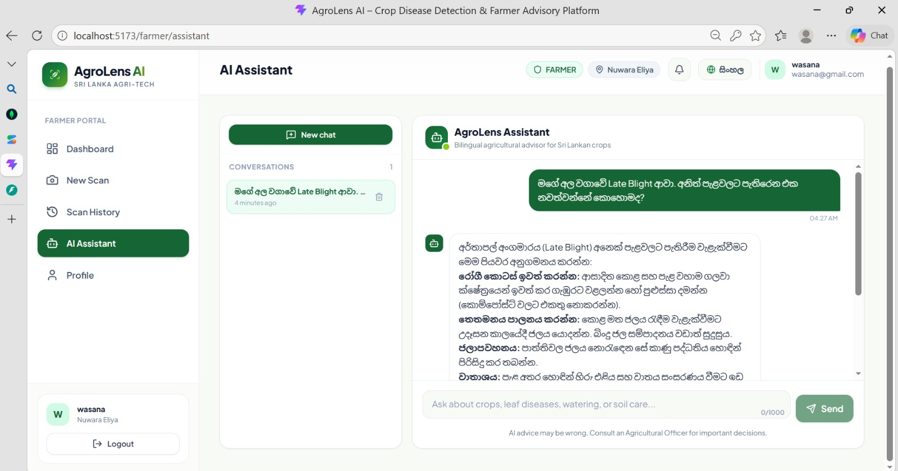
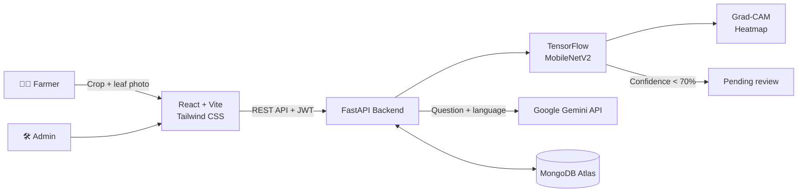

<div align="center">

# 🌿 AgroLens AI

### Crop Disease Detection & Farmer Advisory Platform

**Snap a leaf. Know the disease. Understand why.**


</div>

---

## 📑 Table of Contents

- [Overview](#-overview)
- [Highlights](#-highlights)
- [Who Is This For?](#-who-is-this-for)
- [Key Features](#-key-features)
- [Example Walkthrough](#-example-walkthrough)
- [Tech Stack](#️-tech-stack)
- [System Architecture](#️-system-architecture)
- [Machine Learning & Explainability](#-machine-learning--explainability)
- [Project Structure](#-project-structure)
- [API Endpoints](#-api-endpoints)
- [Getting Started](#-getting-started)
- [Testing](#-testing)
- [Security Notes](#-security-notes)
- [Project Status](#-project-status)
- [Limitations & Future Work](#-limitations--future-work)
- [Author](#-author)
- [Disclaimer](#️-disclaimer)

---
## 📸 Screenshots

| Dashboard | Result + Grad-CAM | AI Assistant |
|---|---|---|
|  |  |  |


## 📖 Overview

### The Problem

Farmers in Sri Lanka often cannot identify crop diseases quickly or accurately in the field. Reaching an Agricultural Officer takes time, and by the time a diagnosis arrives the disease has often spread across the plot. The result is delayed treatment, wrong or excessive pesticide use and avoidable yield losses.

### The Solution

**AgroLens AI** is a full-stack, explainable crop disease detection platform. A farmer selects the crop, uploads a photo of an affected leaf, and receives:

- A **disease diagnosis** with a **confidence score** and the **top 3 predictions**
- A **Grad-CAM heatmap** that highlights the parts of the leaf that drove the prediction
- **Symptoms, treatment and prevention** information in **Sinhala or English**
- An **AI farming assistant** (Google Gemini) that answers follow-up questions in Sinhala or English
- A **"pending review"** flag on uncertain results, so they are not treated as final

### Why Explainability Matters

A farmer is unlikely to act on a label alone. Showing **where** on the leaf the model saw the disease builds trust, makes wrong predictions easier to spot, and helps an expert verify the result. Combined with a confidence threshold, AgroLens AI is designed to keep a **human in the loop** instead of letting the model decide everything.

---

## 🌟 Highlights

| | |
|---|---|
| 🎯 **End-to-end ML** | Colab training notebook → saved Keras model → FastAPI inference service → React UI |
| 🔍 **Explainable by design** | A Grad-CAM heatmap is generated for every prediction |
| 🌾 **Crop-aware prediction** | Crop selection limits predictions to that crop's classes, reducing tomato ↔ potato blight confusion |
| 🚦 **Confidence threshold** | Results below 70% confidence are marked *pending review* |
| 🤖 **Bilingual AI assistant** | Gemini-powered chatbot in Sinhala and English, restricted to farming topics |
| 🔐 **Secured API** | JWT access + refresh tokens, bcrypt, login lockout, rate limiting, role-based access |
| 🛠️ **Admin panel** | User management, treatment content management, diagnoses and platform analytics |
| 📱 **Mobile-first, bilingual UI** | Sinhala / English interface designed for phone users |

---

## 👥 Who Is This For?

- **Farmers** who need a fast first opinion on a sick plant, in their own language
- **Agricultural Officers** who need to verify uncertain AI diagnoses
- **Administrators** who manage users and verified treatment information
- **Learners** studying computer vision, explainable AI and full-stack ML deployment


---

## ✨ Key Features

- **Leaf disease detection:** MobileNetV2 classifies 15 classes across Tomato, Potato and Bell Pepper, with a confidence score and top 3 predictions.
- **Crop selection:** Predictions are limited to the selected crop, with a warning if the photo may not match it.
- **Grad-CAM explainability:** A heatmap shows which parts of the leaf influenced the result.
- **Bilingual treatment info:** Symptoms, treatment and prevention in Sinhala and English, managed by the admin.
- **AI farming assistant:** Gemini chatbot for farming questions in Sinhala or English; no pesticide brands or dosages.
- **Farmer dashboard:** Scan stats, recent scans, condition chart and full history.
- **Role-based access:** Farmer, Agricultural Officer and Admin portals.
- **Admin panel:** Overview analytics, user, treatment and diagnosis management.
- **Security:** Access + refresh tokens, login lockout, rate limiting and security headers.
- **Responsive UI:** Sinhala / English interface for desktop and mobile.

---


## 📸 Screenshots

### Farmer Dashboard


### AI Assistant (Sinhala)


### New Scan – Crop Selection


---


## 🧭 Example Walkthrough

The farmer selects a crop, uploads a leaf photo and clicks **Analyze Leaf**.

| | Tomato | Potato |
|---|---|---|
| Symptom | Dark, water-soaked patches | Brown spots with rings |
| Diagnosis | Tomato – Late Blight | Potato – Early Blight |
| Confidence < 70% | Pending review | Pending review |

Then the farmer can ask the **AI Assistant**:

> *"මගේ තක්කාලි කොළවල මේ රෝගය ආවේ ඇයි?"* — *(Why did this disease appear on my tomato leaves?)*

> Field photos usually get lower confidence than the plain-background training images.

<!--
## 📸 Screenshots
Add images to docs/screenshots/ and uncomment.

| Dashboard | Result + Grad-CAM | AI Assistant |
|---|---|---|
|  |  |  |
-->

---

## 🛠️ Tech Stack

| Layer | Technologies |
|---|---|
| **Frontend** | React, Vite, Tailwind CSS v4, React Router, Axios, Recharts, Framer Motion, Lucide React, React Markdown |
| **Backend** | Python 3.13, FastAPI, Uvicorn, Pydantic v2 |
| **Database** | MongoDB Atlas, Motor (async driver), dnspython |
| **Authentication** | JWT (python-jose), bcrypt, httpOnly refresh-token cookies |
| **Machine Learning** | TensorFlow 2.21 / Keras, MobileNetV2, NumPy, Pillow |
| **Explainability** | Grad-CAM |
| **Generative AI** | Google Gemini API (`google-genai` SDK) |
| **Training environment** | Google Colab (T4 GPU), PlantVillage dataset (Kaggle) |
| **Tools** | Git, GitHub, VS Code |

---

## 🏗️ System Architecture



**Request flow:** the farmer selects a crop and uploads a leaf photo → FastAPI resizes it to 224 × 224 and runs MobileNetV2 → predictions are limited to the selected crop → Grad-CAM generates a heatmap → the diagnosis, confidence and treatment information are saved in MongoDB and returned to the dashboard → results below 70% confidence are marked *pending review*.

---

## 🧠 Machine Learning & Explainability

### 1. Dataset

The model is trained on the **PlantVillage** dataset (colour leaf images, Kaggle).

| Item | Details |
|---|---|
| Crops | Tomato, Potato, Bell Pepper |
| Classes | 15 (diseases + healthy) |
| Split | 70% train / 15% validation / 15% test (fixed seed) |
| Input size | 224 × 224 × 3 |
| Augmentation | Random flip, rotation, zoom, contrast |
| Preprocessing | `mobilenet_v2.preprocess_input` |

**Supported classes**

| Crop | Classes |
|---|---|
| 🍅 Tomato (10) | Bacterial spot, Early blight, Late blight, Leaf mold, Septoria leaf spot, Spider mites, Target spot, Yellow leaf curl virus, Mosaic virus, Healthy |
| 🥔 Potato (3) | Early blight, Late blight, Healthy |
| 🫑 Bell Pepper (2) | Bacterial spot, Healthy |

### 2. Model

| Stage | Details |
|---|---|
| Base | MobileNetV2 with ImageNet weights, `include_top=False` |
| Head | GlobalAveragePooling2D → Dropout (0.3) → Dense (softmax) |
| Stage 1 – Feature extraction | Base frozen, Adam (lr = 1e-3), up to 10 epochs, EarlyStopping + ModelCheckpoint |
| Stage 2 – Fine-tuning | Last 30 layers unfrozen, Adam (lr = 1e-5), up to 10 epochs |

MobileNetV2 was chosen because it is lightweight enough for fast inference on a modest server, while transfer learning gives strong results from a limited dataset.

### 3. Class Imbalance & Cross-Crop Confusion

PlantVillage contains far more tomato images than potato images, and **Early blight and Late blight look very similar on tomato and potato leaves**. During testing, potato leaves were sometimes predicted as tomato blight.

This is handled with **crop-aware prediction**:

- The farmer selects the crop before scanning
- Softmax probabilities are limited to that crop's classes and renormalised
- A **crop-match score** (the original probability mass of the selected crop's classes) is returned
- A low crop-match score marks the result as *pending review* and warns that the photo may not match the selected crop

### 4. Evaluation

The training notebook evaluates the model on the held-out test set and saves **accuracy, weighted precision, recall and F1-score** to `model_metrics.json`, together with a classification report and confusion matrix. The backend serves these values at `GET /api/model/info`.

> PlantVillage images use plain, controlled backgrounds, so accuracy on real field photos is expected to be lower than the test-set figures.

### 5. Confidence Tiers

| Confidence | Display | Status |
|---|---|---|
| 🟢 ≥ 85% | High confidence | Result shown |
| 🟡 70 – 85% | Moderate confidence | Result shown |
| 🔴 < 70% | Low confidence | **Pending review** |

### 6. Grad-CAM

Grad-CAM computes the gradients of the predicted class with respect to MobileNetV2's last convolutional layer (`Conv_1`). The resulting heatmap is resized and overlaid on the original image; red and yellow regions show where the model focused.

---

## 📂 Project Structure

```
AgroLens AI/
├── Backend/                      # FastAPI service
│   ├── app/
│   │   ├── core/                 # Settings, MongoDB, JWT, sessions, rate limiting
│   │   ├── models/               # Pydantic schemas
│   │   ├── routes/               # auth, predict, chat, admin
│   │   ├── services/             # ml_service.py, gradcam.py, gemini_service.py
│   │   ├── ml_models/            # Trained model files (git-ignored)
│   │   └── main.py
│   ├── scripts/                  # create_admin, seed_treatments, migrations
│   ├── uploads/                  # Leaf images and heatmaps (git-ignored)
│   ├── .env.example
│   └── requirements.txt
├── Frontend/                     # React + Vite + Tailwind
│   ├── src/
│   │   ├── components/           # ui, layout, admin components
│   │   ├── context/              # AuthContext, LanguageContext
│   │   ├── i18n/                 # en.json, si.json
│   │   ├── layouts/
│   │   ├── pages/                # Landing, Auth, Farmer, Admin
│   │   ├── routes/               # ProtectedRoute, RoleRoute
│   │   └── services/             # Axios instance and API modules
│   ├── .env.example
│   └── package.json
├── ML/
│   ├── notebooks/                # agrolens_training.ipynb (Google Colab)
│   └── models/                   # Model outputs (git-ignored)
└── README.md
```

---

## 🔌 API Endpoints

| Method | Path | Auth | Description |
|---|---|---|---|
| `GET` | `/api/health` | No | API and MongoDB status |
| `POST` | `/api/auth/register` | No | Create a farmer or officer account |
| `POST` | `/api/auth/login` | No | Authenticate and receive tokens |
| `POST` | `/api/auth/refresh` | Cookie | Issue a new access token |
| `POST` | `/api/auth/logout` | Bearer | Log out of the current session |
| `GET` | `/api/auth/me` | Bearer | Current user profile |
| `POST` | `/api/predict` | Farmer | Upload a leaf image with the crop → diagnosis + Grad-CAM |
| `GET` | `/api/predict/history` | Farmer | Farmer's scan history |
| `GET` | `/api/predict/{id}` | Farmer | One diagnosis with treatment information |
| `GET` | `/api/model/info` | No | Model classes and evaluation metrics |
| `POST` | `/api/chat` | Bearer | Send a message to the AI assistant |
| `GET` | `/api/chat/conversations` | Bearer | List the user's conversations |
| `GET` | `/api/admin/users` | Admin | Users with search, filters and pagination |
| `GET` | `/api/admin/treatments` | Admin | Treatment information |
| `GET` | `/api/admin/diagnoses` | Admin | All diagnoses with filters |
| `GET` | `/api/admin/analytics/overview` | Admin | Platform KPIs |

Interactive Swagger docs are available at `/docs` when the backend is running.

---

## 🚀 Getting Started

### Prerequisites

- **Python 3.13** (TensorFlow 2.21 does not support Python 3.14)
- **Node.js 18+** and npm
- A **MongoDB Atlas** cluster (free M0 tier is enough)
- A **Google AI Studio** API key for Gemini

### 1. Clone

```bash
git clone https://github.com/damsaraninawela2002-ux/AgroLens-AI.git
cd AgroLens-AI
```

### 2. Train the Model

Model files are not committed because of their size.

1. Open `ML/notebooks/agrolens_training.ipynb` in Google Colab and select a **T4 GPU** runtime.
2. Click **Runtime → Run all**. The notebook downloads PlantVillage, trains and evaluates the model, and downloads the output files.
3. Copy `agrolens_model.keras`, `class_names.json` and `model_metrics.json` into `Backend/app/ml_models/`.

### 3. Backend

```bash
cd Backend
py -3.13 -m venv venv
.\venv\Scripts\activate
pip install -r requirements.txt
copy .env.example .env
```

Edit `.env` and set `MONGODB_URI`, `JWT_SECRET_KEY`, `GEMINI_API_KEY` and `GEMINI_MODEL`. Then:

```bash
python scripts/seed_treatments.py
python scripts/create_admin.py
uvicorn app.main:app --reload
```

| Check | URL |
|---|---|
| Health | http://localhost:8000/api/health |
| Swagger docs | http://localhost:8000/docs |

### 4. Frontend

Open a second terminal:

```bash
cd Frontend
npm install
copy .env.example .env
npm run dev
```

The app runs at **http://localhost:5173**. Register as a farmer, select a crop and scan a leaf.

### Environment Variables

| File | Variable | Purpose |
|---|---|---|
| `Backend/.env` | `MONGODB_URI` | MongoDB connection string |
| `Backend/.env` | `DATABASE_NAME` | Database name (e.g. `agrolens_db`) |
| `Backend/.env` | `JWT_SECRET_KEY` | Secret used to sign JWTs |
| `Backend/.env` | `ACCESS_TOKEN_EXPIRE_MINUTES` | Access token lifetime (default 15) |
| `Backend/.env` | `REFRESH_TOKEN_EXPIRE_DAYS` | Refresh token lifetime (default 7) |
| `Backend/.env` | `ALLOWED_ORIGINS` | Allowed frontend origins |
| `Backend/.env` | `COOKIE_SECURE` | `true` in production (HTTPS) |
| `Backend/.env` | `GEMINI_API_KEY` | Google Gemini API key |
| `Backend/.env` | `GEMINI_MODEL` | Gemini model name (e.g. `gemini-flash-latest`) |
| `Frontend/.env` | `VITE_API_URL` | Backend base URL (default `http://localhost:8000`) |

See the `.env.example` files for the full list. Real `.env` files are never committed.

---

## 🧪 Testing

The main flows have been tested manually through Swagger UI (`/docs`) and the web interface:

- Register, login, token refresh and logout
- Leaf prediction for tomato and potato images, with crop selection
- Grad-CAM heatmap generation
- AI assistant replies in Sinhala and English
- Admin user and treatment management

Automated tests are planned (see [Future Work](#-limitations--future-work)).

---

## 🔐 Security Notes

- Passwords are hashed with **bcrypt** and never stored in plain text
- Short-lived **JWT access tokens** plus **rotating refresh tokens** in httpOnly cookies, tracked as sessions
- **Account lockout** after repeated failed logins and **rate limiting** on auth endpoints
- **Role-based access control** on protected routes
- Security headers (`X-Content-Type-Options`, `X-Frame-Options`, `Referrer-Policy`) and CORS configured through environment variables
- Secrets are read from environment variables; `.env` files, uploaded images and model files are git-ignored

---

## 🚧 Project Status

AgroLens AI runs locally and is under active development.

| Area | Status |
|---|---|
| Leaf disease detection, crop selection, Grad-CAM | ✅ Working |
| Farmer dashboard and scan history | ✅ Working |
| Gemini AI assistant (Sinhala / English) | ✅ Working |
| Authentication and security | ✅ Working |
| Admin panel | ✅ Working |
| Agricultural Officer review workflow and notifications | 🚧 In progress |
| Verified treatment content from official sources | 🚧 In progress |
| Deployment and live demo | 📅 Planned |

---

## 🔭 Limitations & Future Work

This is an educational prototype. It is not a replacement for professional agricultural advice.

**Known limitations**

- PlantVillage images use plain backgrounds, so accuracy on real field photos is lower
- Only Tomato, Potato and Bell Pepper leaves are supported for image diagnosis
- Early and Late blight look similar across tomato and potato; crop selection reduces but does not remove this confusion
- The dataset is imbalanced (many more tomato images than potato images)
- Treatment information still needs to be verified from Department of Agriculture sources

**Possible next steps**

- Complete the Agricultural Officer review workflow with farmer notifications
- Officer feedback loop for retraining, with versioned models
- District disease outbreak map with alerts
- Add rice and chili disease classes and collect real Sri Lankan field images
- Class weights and stronger augmentation to improve field accuracy
- ESP32 IoT sensor dashboard (soil moisture, temperature, humidity)
- Automated tests and CI/CD with GitHub Actions
- Deployment (Vercel + cloud backend) with a live demo

---


## 📄 License

This project is developed for educational purposes and released under the [MIT License](LICENSE).


## 👩‍💻 Author

**Damsarini Nawela**
HNDIT student, Advanced Technological Institute – Rathnapura

[](https://github.com/damsaraninawela2002-ux)
[](https://www.linkedin.com/in/damsarini-nawela-0816243ba)
[](https://frontend-1-henna.vercel.app/)

---
\


## ⚠️ Disclaimer

This project is built for educational and portfolio purposes using the public **PlantVillage** dataset. Diagnoses, confidence scores, heatmaps and AI assistant replies are **decision-support suggestions** and must not replace advice from a qualified Agricultural Officer. Always consult your local Agricultural Officer or the Department of Agriculture (**Govi Sahana Sevaya – 1920**) before applying any chemical treatment.

<div align="center">

⭐ If you find this project useful, please give it a star!

</div>

